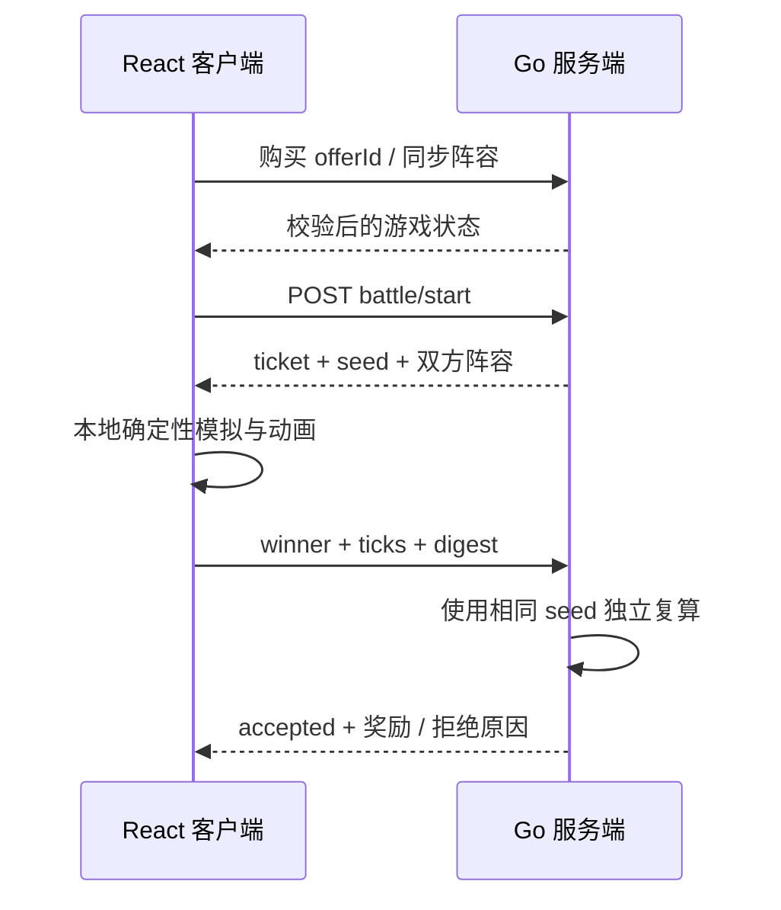

# Seedbound · 命轮战棋

一个可运行的自走棋 MVP。前端负责棋盘交互和战斗演出，Go 服务端负责商店抽取、经济、阵容合法性，以及战斗结果的确定性复算校验。

## 当前玩法

- 开局拥有 3 枚棋子、12 金币和 5 个服务端生成的商店报价。
- 购买报价时必须提交对应的 `offerId`；重复购买、过期报价、金币不足和备战席已满都会被拒绝。
- 选择棋子后点击空棋格即可部署，阵容人口、棋子归属和格子冲突由服务端校验。
- 三张同名同星棋子会自动合成为更高星级；已上阵副本合成时会保留一个合法站位。
- 单位使用确定性 BFS 绕开阻挡，近战和远程拥有不同攻击距离。
- 普攻和受击会积累法力，8 种棋子各自拥有独立技能、护盾、治疗或范围伤害效果。
- 羁绊会进入服务端战斗快照：辉焰增加攻击、生息增加生命、元素提供初始法力、暗钢提供护甲与初始护盾；重复棋子不重复计数。
- 开战时服务端签发一次性 battle ticket、随机 seed 和敌方阵容。
- React 客户端运行确定性战斗模拟并播放事件；结束后只提交 `winner + ticks + digest`。
- Go 服务端使用 ticket 中的阵容和 seed 独立复算。只有三项完全一致才结算金币、生命、胜负和下一回合。

## 架构



核心目录：

```text
cmd/server/              Go 服务入口
internal/game/catalog.go 棋子配置
internal/game/combat.go  服务端确定性战斗引擎
internal/game/store.go   游戏状态、商店与校验流程
internal/game/http.go    REST API 与静态文件服务
web/src/combat.ts        与 Go 对齐的客户端战斗引擎
web/src/App.tsx          棋盘、商店、战斗和结算界面
```

## 本地启动

需要 Go 1.22+、Node.js 20+。

开发模式建议打开两个终端：

```powershell
# 终端 1：后端，默认 http://localhost:8091
go run ./cmd/server

# 终端 2：前端，默认 http://localhost:5173
cd web
npm install
npm run dev
```

单端口生产预览：

```powershell
cd web
npm ci
npm run build
cd ..
go run ./cmd/server
```

打开 <http://localhost:8091>。Go 服务会从 `web/dist` 提供前端资源。

Docker：

```powershell
docker build -t seedbound .
docker run --rm -p 8091:8091 seedbound
```

## REST API

| 方法 | 路径 | 用途 |
| --- | --- | --- |
| `GET` | `/api/catalog` | 获取棋子图鉴和棋盘配置 |
| `POST` | `/api/games` | 创建一局游戏 |
| `GET` | `/api/games/{id}` | 恢复游戏状态 |
| `POST` | `/api/games/{id}/shop/refresh` | 支付金币刷新商店 |
| `POST` | `/api/games/{id}/shop/buy` | 使用 slot + offerId 购买 |
| `PUT` | `/api/games/{id}/formation` | 校验并替换阵容 |
| `POST` | `/api/games/{id}/battle/start` | 获取 ticket、seed 和战斗快照 |
| `POST` | `/api/games/{id}/battle/{ticket}/verify` | 提交客户端战斗摘要并复算 |

## 测试

```powershell
go test ./...
cd web
npm run build
```

测试覆盖了模拟确定性、技能释放、绕障寻路、三合一升星、伪造结果不结算和重叠编队拒绝。前后端使用相同的 xorshift32 随机数算法、单位排序、寻路、技能结算和 FNV-1a 事件摘要。

## MVP 边界与下一步

目前状态保存在单进程内存中，敌人由 PvE 模板生成，刷新服务会清空数据。要做成正式多人项目，建议按这个顺序扩展：

1. 接入 PostgreSQL/Redis、账号鉴权和断线恢复。
2. 增加公共棋子池、升星合成、装备、技能和羁绊效果。
3. 增加匹配房间和其他玩家阵容快照，仍沿用现有 battle ticket 校验协议。
4. 将结算写入幂等事务，并加入 ticket 过期、限流和服务端签名。
5. 对客户端上报增加事件抽样/遥测；正式竞技模式可改为服务端权威模拟、客户端只播放。
